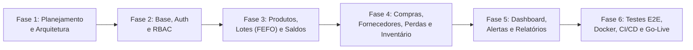

# 01. Documento de Visão Geral do Produto e Análise Crítica de Engenharia

**Projeto:** Japa em Casa — Sistema Profissional de Gestão de Estoque e Custos para Restaurantes (ERP Food Service)  
**Versão:** 1.0.0  
**Fase:** Fase 1 — Planejamento e Engenharia de Requisitos  
**Status:** Aguardando Validação

---

## 1. Visão Geral do Produto

O **Japa em Casa — Stock & Food Service ERP** é uma solução comercial de classe empresarial projetada especificamente para a realidade operacional de restaurantes (com atenção especial a operações de alta perecibilidade e precisão de porcionamento, como culinária japonesa, além de restaurantes gerais, bares e dark kitchens).

Diferente de sistemas genéricos de varejo que tratam produtos como itens estáticos de prateleira, o setor de *Food Service* enfrenta desafios críticos diários:
- **Perecibilidade extrema:** Peixes frescos, hortifrúti e laticínios possuem janelas de validade de horas ou poucos dias.
- **Transformação de insumos e fator de correção:** Compra-se o peixe inteiro em quilogramas (peso bruto), limpa-se (perda técnica/aparas) e consome-se em gramas ou porções nas receitas (peso líquido).
- **Múltiplas unidades de medida:** Compra-se em Caixas ou Fardos, armazena-se em Pacotes ou Litros e dá-se baixa em Gramas ou Mililitros.
- **Ambiente hostil de operação:** Estoquistas e cozinheiros operam em câmaras frias, docas de recebimento e cozinhas movimentadas, exigindo uma **Progressive Web App (PWA)** rápida, responsiva, operável com uma mão no smartphone ou tablet e com suporte a leitura de código de barras pela câmera.

### 1.1. Proposta de Valor
Transformar o estoque de um "centro de custo invisível" em uma central estratégica de preservação de margem de lucro, garantindo:
1. **Rastreabilidade Total (Audit Trail):** Nenhuma grama ou unidade entra ou sai sem registro de quem, quando, de qual lote e por qual motivo.
2. **Controle Financeiro Real (CMV e CMP):** Cálculo automático do Custo Médio Ponderado (CMP) a cada nota/recebimento e visibilidade imediata do impacto financeiro de perdas e desperdícios.
3. **Prevenção Ativa de Perdas (FEFO):** Indicação automática de quais lotes devem sair primeiro (*First Expired, First Out*) e bloqueio automático de lotes vencidos no saldo disponível.
4. **Abastecimento Inteligente:** Alertas em tempo real baseados em Ponto de Reposição, Estoque de Segurança e consumo médio diário.

---

## 2. Público-Alvo e Perfis de Uso

| Perfil | Contexto de Uso | Dispositivo Principal | Objetivo Principal |
| :--- | :--- | :--- | :--- |
| **Proprietário / Diretor / Gerente** | Escritório ou remotamente | Notebook / Smartphone | Acompanhar valor imobilizado em estoque, aprovar pedidos de compra, analisar CMV e perdas financeiras. |
| **Gestor de Estoque / Comprador** | Administração do restaurante | Desktop / Tablet | Cadastrar insumos, cotar fornecedores, emitir ordens de compra, auditar inventários e ajustar parâmetros de estoque mínimo/segurança. |
| **Estoquista / Recebedor** | Doca de recebimento, despensa, câmara fria | Smartphone / Tablet (PWA) | Conferir mercadorias no ato da entrega, registrar validades/lotes, dar baixa para a cozinha e registrar descartes/perdas. |

---

## 3. Análise Crítica de Engenharia (Lacunas Identificadas, Riscos e Soluções)

Em conformidade com as boas práticas de arquitetura de sistemas ERP para restaurantes, realizamos uma análise crítica sobre os requisitos iniciais. Abaixo detalhamos os **requisitos ocultos/ausentes**, **riscos operacionais reais** e **como nossa arquitetura os resolve sem adicionar complexidade desnecessária**:

### 3.1. Conversão de Unidades de Medida (Compra vs. Estoque vs. Consumo)
- **Problema real:** O fornecedor vende refrigerante em `Fardo (12 latas)` ou shoyu em `Galão (20 Litros)`, mas o estoque controla em `Unidade (lata)` ou `Litro`, e a cozinha requisita em `Mililitro (ml)` ou `Quilograma (kg)`. Se o sistema tiver apenas uma unidade de medida estática por produto, o recebedor errará contas matemáticas na doca ao dar entrada na nota fiscal.
- **Solução arquitetural:** Todo produto possui uma **Unidade Base de Controle de Estoque** (ex: `KG`, `L`, `UN`) na qual o saldo e o Custo Médio Ponderado (CMP) são mantidos com precisão decimal (`DECIMAL(12,4)`). Na tabela associativa `ProductSupplier` e na tabela `UnitConversion`, cadastramos fatores de conversão de compra (ex: `1 Caixa = 10 KG`). No recebimento da compra, o usuário informa "Recebi 3 Caixas" e o sistema converte automaticamente para `+30,0000 KG` no estoque e dilui o custo unitário por KG.

### 3.2. Validade Pós-Abertura (Validade Secundária / Manipulação)
- **Problema real:** Um insumo fechado (ex: creme de leite UHT ou peça de salmão embalada a vácuo) tem validade de 30 a 90 dias. Porém, uma vez aberto ou porcionado, a vigilância sanitária (ANVISA RDC 216) exige que sua validade caia para 2 ou 3 dias sob refrigeração.
- **Solução arquitetural:** Adicionamos no cadastro do produto o atributo `after_open_shelf_life_days` (Prazo de validade após aberto) e a funcionalidade rápida de fracionamento/abertura de lote, que ajusta ou gera um sub-lote com a nova data de vencimento reduzida.

### 3.3. Tolerância de Recebimento e Validade Curta na Doca (Shelf-Life Mínimo)
- **Problema real:**
  1. Em produtos de peso variável (carnes, peixes, hortifrúti), pede-se `20,00 kg` de salmão e o fornecedor entrega `20,45 kg` ou `19,60 kg`.
  2. O fornecedor tenta entregar um lote que vence em 2 dias para um produto cujo giro leva 10 dias.
- **Solução arquitetural:**
  - Registro de Recebimento desacoplado do Pedido de Compra (`GoodsReceipt`), permitindo recebimento parcial, total ou com divergência justificada (atualizando o estoque *exclusivamente* pela quantidade física real aceita).
  - Atributo `min_acceptable_shelf_life_days` no produto: se o estoquista digitar no recebimento uma data de validade inferior ao limite mínimo aceitável, o sistema exibe um alerta amarelo/vermelho imediato na tela do celular exigindo autorização ou sugerindo recusa no ato da entrega.

### 3.4. Ficha Técnica Simplificada e Rendimento (Fator de Correção / Aparas)
- **Problema real:** O restaurante utiliza o mesmo insumo em várias receitas (ex: arroz japonês, alga nori, salmão). Além disso, ao limpar um peixe de 5 kg, aproveita-se 3,5 kg de filé limpo (70% de rendimento).
- **Solução arquitetural:**
  - Adição do campo `yield_percentage` (Percentual de Rendimento Padrão / Fator de Correção) no Produto para apoiar o cálculo de custo real por porção.
  - Na movimentação de `SAÍDA PARA PRODUÇÃO`, possibilidade de vincular o centro de custo ou destino (ex: *Sushibar*, *Cozinha Quente*, *Bar*) para rastrear qual setor consome ou desperdiça mais.

### 3.5. Concorrência e Condições de Corrida (Race Conditions)
- **Problema real:** Dois estoquistas usam seus celulares simultaneamente. Um registra a saída de 5 kg de salmão para produção enquanto outro registra 2 kg de perda do mesmo lote que tinha apenas 6 kg disponíveis. Sem controle transacional rígido, o lote ficaria com `-1 kg` (violando a Regra de Negócio #1).
- **Solução arquitetural:**
  - Uso de transações ACID no PostgreSQL com **Pessimistic Locking (`SELECT ... FOR UPDATE`)** nas linhas de `Stock` e `StockLot` durante qualquer operação de saída, ajuste ou transferência.
  - Restrição nativa no banco de dados (`CHECK (quantity >= 0)`) como última barreira de integridade física.

### 3.6. Operação em Câmaras Frias (Conectividade Instável)
- **Problema real:** Câmaras frigoríficas e subsolos de restaurantes possuem isolamento térmico metálico que bloqueia sinal Wi-Fi e 4G/5G.
- **Solução arquitetural:** Como um **PWA (Progressive Web App)** moderno, o frontend fará cache inteligente das listas de produtos e lotes via Service Worker + TanStack Query Persist, e enfileirará contagens de inventário no `IndexedDB` local do navegador quando offline, sincronizando assim que o estoquista sair da câmara fria (com validação de conflitos no servidor).

### 3.7. Inventário Cego (Prevenção de Fraude e Vício de Contagem)
- **Problema real:** Se na tela de conferência física de inventário o sistema mostrar ao estoquista "Quantidade no Sistema: 15 unidades", o funcionário preguiçoso ou mal-intencionado apenas digita "15" sem contar fisicamente.
- **Solução arquitetural:** Por padrão, a tela de contagem para o perfil **Estoquista** opera em modo **Inventário Cego** (oculta a quantidade esperada do sistema). Apenas após submeter a contagem, o **Gestor de Estoque** ou **Gerente** visualiza o mapa comparativo (`Saldo Sistema` vs. `Saldo Físico` vs. `Divergência em R$`) para aprovar o ajuste ou solicitar recontagem.

---

## 4. Escopo do Produto e Fases de Entrega

O projeto está estruturado em **6 Fases Evolutivas** bem delimitadas:

---

## 5. Indicadores de Sucesso do Produto (KPIs de Negócio)

1. **Redução de Desperdício por Vencimento:** Reduzir em até 80% as perdas por validade expirada nos primeiros 90 dias de uso graças ao FEFO e aos alertas escalonados (30, 15, 7, 3 e 0 dias).
2. **Acuracidade de Estoque:** Atingir > 98% de convergência entre o estoque físico e o estoque contábil no sistema.
3. **Agilidade Operacional:** Tempo médio para registrar uma baixa de produção ou perda no smartphone inferior a **15 segundos** (máximo de 3 toques na tela).
4. **Visibilidade de Custos:** Atualização instantânea (tempo real) do Custo Médio Ponderado (CMP) e do valor financeiro total do estoque após cada recebimento de mercadoria.
