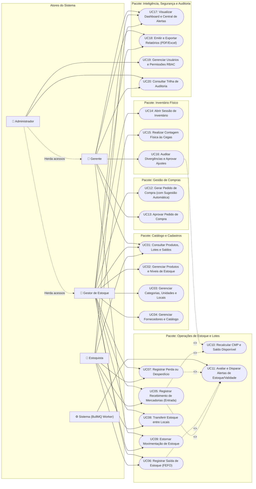

# 03. Atores, Matriz RBAC e Casos de Uso (UML e Descrições Textuais)

**Projeto:** Japa em Casa — Sistema Profissional de Gestão de Estoque para Restaurantes  
**Módulo:** Engenharia de Requisitos — Modelagem Comportamental

---

## 1. Identificação dos Atores e Matriz de Permissões (RBAC)

O sistema possui **4 atores humanos** principais e **1 ator sistêmico** (Motor de Jobs/Agendador):

1. **Estoquista (`STOCK_CLERK`):** Operador de linha de frente responsável pela conferência física no recebimento, armazenamento nas câmaras/despensas, baixas diárias para produção, registro de descartes e contagem física nos inventários.
2. **Gestor de Estoque (`STOCK_MANAGER`):** Responsável tático pelo cadastro de produtos, categorias, fornecedores, elaboração de pedidos de compra, abertura de inventários, estornos operacionais e análise de relatórios de giro e perdas.
3. **Gerente (`GENERAL_MANAGER`):** Responsável estratégico e financeiro. Acompanha indicadores do Dashboard, aprova pedidos de compra acima da alçada, aprova ajustes de inventário com impacto financeiro e autoriza exceções auditadas.
4. **Administrador (`ADMIN`):** Superusuário com acesso irrestrito, responsável pela gestão de usuários, configuração de papéis e permissões (RBAC), parâmetros globais de alertas e auditoria de segurança.
5. **Motor de Automação / Scheduler (`SYSTEM_WORKER`):** Ator sistêmico (BullMQ + Cron) que verifica diariamente a validade dos lotes à meia-noite, bloqueia lotes vencidos, calcula médias históricas de consumo e dispara alertas automáticos.

### 1.1. Matriz de Controle de Acesso por Funcionalidade (RBAC)

| Módulo / Ação | Permissão (`slug`) | Estoquista | Gestor de Estoque | Gerente | Administrador |
| :--- | :--- | :---: | :---: | :---: | :---: |
| **Dashboard:** Visualizar KPIs operacionais | `dashboard:view_operational` | ✅ | ✅ | ✅ | ✅ |
| **Dashboard:** Visualizar KPIs financeiros (CMV/Valor R$) | `dashboard:view_financial` | ❌ | ✅ | ✅ | ✅ |
| **Produtos:** Consultar catálogo, saldos e lotes | `products:read` | ✅ | ✅ | ✅ | ✅ |
| **Produtos:** Cadastrar, editar e parametrizar níveis | `products:write` | ❌ | ✅ | ✅ | ✅ |
| **Categorias / Unidades / Locais:** Gerenciar tabelas | `catalog:manage` | ❌ | ✅ | ❌ | ✅ |
| **Movimentações:** Registrar Entrada (Recebimento) | `movements:create_in` | ✅ | ✅ | ❌ | ✅ |
| **Movimentações:** Registrar Saída (Produção/Consumo) | `movements:create_out` | ✅ | ✅ | ❌ | ✅ |
| **Movimentações:** Registrar Transferência Interna | `movements:transfer` | ✅ | ✅ | ❌ | ✅ |
| **Movimentações:** Realizar Estorno Auditável | `movements:reverse` | ❌ | ✅ | ✅ | ✅ |
| **Perdas:** Registrar perda/desperdício | `waste:create` | ✅ | ✅ | ❌ | ✅ |
| **Perdas:** Visualizar relatório financeiro de perdas | `waste:read_financial` | ❌ | ✅ | ✅ | ✅ |
| **Compras:** Criar solicitação / pedido de compra | `purchases:create` | ❌ | ✅ | ✅ | ✅ |
| **Compras:** Aprovar ou cancelar pedido de compra | `purchases:approve` | ❌ | ❌ | ✅ | ✅ |
| **Fornecedores:** Cadastrar e editar fornecedores | `suppliers:manage` | ❌ | ✅ | ✅ | ✅ |
| **Inventário:** Abrir sessão de inventário | `inventory:open` | ❌ | ✅ | ✅ | ✅ |
| **Inventário:** Registrar contagem física (às cegas) | `inventory:count` | ✅ | ✅ | ❌ | ✅ |
| **Inventário:** Aprovar divergências e ajustar saldo | `inventory:approve` | ❌ | ❌ | ✅ | ✅ |
| **Relatórios:** Gerar e exportar (PDF/Excel) | `reports:export` | ❌ | ✅ | ✅ | ✅ |
| **Usuários & RBAC:** Gerenciar contas e permissões | `users:manage` | ❌ | ❌ | ❌ | ✅ |
| **Auditoria:** Consultar logs completos (`AuditLog`) | `audit:read` | ❌ | ❌ | ✅ | ✅ |

---

## 2. Diagrama de Casos de Uso UML

Abaixo está o Diagrama de Casos de Uso estruturado em Mermaid representando os atores, pacotes modulares e relacionamentos (`<<include>>` e `<<extend>>`):

---

## 3. Descrição Textual Detalhada dos Principais Casos de Uso

### UC05 — Registrar Recebimento de Mercadorias (Entrada por Compra)

- **Código:** UC05
- **Atores Primários:** Estoquista, Gestor de Estoque.
- **Pré-condições:** O usuário está autenticado; existe um Pedido de Compra no status `APROVADO`, `ENVIADO_FORNECEDOR` ou `PARCIALMENTE_RECEBIDO`.
- **Pós-condições de Sucesso:**
  1. Um novo registro de recebimento (`GoodsReceipt`) é criado.
  2. Novos lotes (`StockLot`) são gerados para cada item recebido com suas respectivas validades.
  3. As movimentações de `ENTRADA_COMPRA` (`StockMovement`) são registradas na unidade base do produto.
  4. O saldo do produto (`Stock`) e seu Custo Médio Ponderado (`CMP`) são recalculados atomicamente.
  5. O status do Pedido de Compra é atualizado para `RECEBIDO` ou `PARCIALMENTE_RECEBIDO`.
- **Fluxo Principal:**
  1. O usuário seleciona o Pedido de Compra pendente de entrega e informa o número da Nota Fiscal e data/hora de chegada.
  2. O sistema lista os itens solicitados no pedido.
  3. Para cada item entregue, o usuário informa:
     - Quantidade física recebida;
     - Número do lote do fabricante (ou solicita geração automática);
     - Data de fabricação (opcional) e **Data de Validade** (obrigatória para perecíveis);
     - Temperatura aferida no recebimento (quando refrigerado/congelado) e Local de Armazenamento de destino.
  4. O sistema converte a quantidade da unidade de compra (ex: `2 Caixas de 10kg`) para a unidade base de estoque (`20,0000 KG`).
  5. O sistema compara a quantidade recebida com a quantidade solicitada no pedido.
  6. O usuário confirma o recebimento.
  7. O sistema executa em transação única no banco de dados: criação dos lotes, gravação das movimentações de entrada, recálculo do CMP, atualização do saldo e atualização do status do pedido.
- **Fluxos Alternativos e de Exceção:**
  - **FA01 — Recebimento Parcial ou com Divergência de Quantidade:** Se a quantidade entregue for menor que a pedida (ex: pediu 20kg de salmão, chegaram 15kg), o sistema exige o preenchimento do motivo da divergência, dá entrada no estoque **apenas nos 15kg efetivamente recebidos**, mantém os 5kg restantes como pendentes e altera o status do pedido para `PARCIALMENTE_RECEBIDO`.
  - **FA02 — Mercadoria com Validade Curta (Alerta de Shelf-Life):** Se a data de validade informada for menor que `Data Atual + Prazo Mínimo Aceitável do Produto`, o sistema exibe um alerta crítico exigindo justificativa/autorização para aceitar o lote ou permitindo recusar o item no ato.
  - **FE01 — Lote Já Vencido:** Se a data de validade informada for anterior à data atual (`< hoje`), o sistema bloqueia a entrada daquele item como estoque disponível.

---

### UC06 — Registrar Saída de Estoque para Produção/Consumo (com FEFO)

- **Código:** UC06
- **Atores Primários:** Estoquista, Gestor de Estoque.
- **Pré-condições:** Usuário autenticado; produto ativo com `Estoque Disponível > 0`.
- **Pós-condições de Sucesso:** Saldo do(s) lote(s) mais próximo(s) do vencimento deduzido; movimentação de `SAIDA_PRODUCAO` ou `SAIDA_CONSUMO` gravada; alertas de estoque mínimo/ponto de reposição avaliados assincronamente.
- **Fluxo Principal:**
  1. No smartphone ou tablet, o usuário aciona "Nova Saída", seleciona o tipo (`SAIDA_PRODUCAO` ou `SAIDA_CONSUMO`) e o setor de destino (ex: *Sushibar*).
  2. O usuário bipa o código de barras pela câmera ou pesquisa o produto pelo nome.
  3. O usuário informa a quantidade a ser retirada (ex: `8,000 KG` de Salmão Fresco).
  4. **Execução do Algoritmo FEFO:** O sistema busca todos os lotes ativos e **não vencidos** daquele produto ordenados por `expiration_date ASC, received_at ASC`:
     - *Exemplo:* Lote A (vence amanhã) tem `5,000 KG`; Lote B (vence em 4 dias) tem `10,000 KG`.
     - O sistema sugere automaticamente retirar `5,000 KG` do Lote A (zerando-o) e `3,000 KG` do Lote B.
  5. O sistema exibe na tela exatamente qual lote e local de armazenamento o estoquista deve pegar fisicamente.
  6. O estoquista confirma a retirada.
  7. O sistema bloqueia os registros no banco (`SELECT FOR UPDATE`), deduz os saldos dos lotes A e B, grava as movimentações vinculadas aos respectivos lotes e atualiza o saldo consolidado do produto.
  8. O sistema dispara o evento interno `stock.movement.created` para verificar se o novo saldo atingiu o Ponto de Reposição, Estoque Mínimo ou Estoque de Segurança.
- **Fluxos Alternativos e de Exceção:**
  - **FA01 — Troca Manual de Lote Justificada:** Caso o Lote A não possa ser utilizado no momento (ex: ainda está em processo de descongelamento controlado), o usuário pode selecionar o Lote B mediante preenchimento de justificativa obrigatória que fica registrada na auditoria.
  - **FE01 — Saldo Disponível Insuficiente (Bloqueio de Estoque Negativo):** Se o produto possuir 10kg físicos no total, mas 4kg estiverem em um lote vencido hoje, o `Estoque Disponível` é de apenas `6,000 KG`. Ao tentar retirar `8,000 KG`, o sistema bloqueia a operação informando que há apenas `6,000 KG` válidos disponíveis.

---

### UC07 — Registrar Perda ou Desperdício

- **Código:** UC07
- **Atores Primários:** Estoquista, Gestor de Estoque.
- **Pré-condições:** Usuário autenticado; lote identificado com saldo físico > 0.
- **Pós-condições de Sucesso:** Registro criado em `WasteRecord` com cálculo do prejuízo financeiro (`Quantidade * CMP`); baixa realizada no lote via movimentação `SAIDA_PERDA` ou `SAIDA_VENCIMENTO`; indicadores de desperdício atualizados no Dashboard.
- **Fluxo Principal:**
  1. O usuário acessa "Registrar Perda / Desperdício".
  2. Seleciona o produto e o lote específico afetado.
  3. Informa a quantidade perdida e seleciona a classificação obrigatória:
     - `VENCIMENTO`
     - `DETERIORACAO`
     - `ARMAZENAMENTO_INADEQUADO` (ex: falha na câmara fria)
     - `ERRO_MANIPULACAO` (ex: corte incorreto ou queima na produção)
     - `EXCESSO_PRODUCAO` (sobra limpa sem reaproveitamento seguro)
     - `DANOS_TRANSPORTE`
     - `OUTROS`
  4. O sistema calcula automaticamente o **Valor Financeiro Estimado da Perda** multiplicando a quantidade perdida pelo Custo Médio Ponderado (CMP) vigente do produto.
  5. O usuário adiciona observações detalhadas e confirma o registro.
  6. O sistema deduz a quantidade do lote, grava o registro em `WasteRecord`, grava a movimentação em `StockMovement` e atualiza os alertas de estoque e desperdício.

---

### UC09 — Estornar Movimentação de Estoque

- **Código:** UC09
- **Atores Primários:** Gestor de Estoque, Gerente, Administrador.
- **Pré-condições:** Existe uma movimentação concluída que foi lançada com erro operacional (ex: digitou 50kg em vez de 5kg).
- **Pós-condições de Sucesso:** Movimentação original marcada como `REVERSED`; nova movimentação inversa gerada com vínculo rastreável; saldos de produto e lote recompostos; log de auditoria gravado.
- **Fluxo Principal:**
  1. O Gestor localiza o lançamento incorreto no Histórico de Movimentações e aciona "Solicitar Estorno".
  2. O sistema exige uma justificativa formal detalhada (mínimo de 15 caracteres).
  3. O sistema valida se o estorno é fisicamente possível (ex: se for estornar uma *Entrada*, verifica se o saldo daquele lote ainda não foi consumido).
  4. O sistema cria uma nova movimentação de sinal inverso referenciando `reversed_movement_id`, restaura os saldos do lote e do produto, recalcula o CMP (se aplicável) e grava um registro imutável em `AuditLog`.

---

### UC15 & UC16 — Realizar Contagem Física e Aprovar Inventário

- **Código:** UC15 / UC16
- **Atores Primários:** Estoquista (Contagem - UC15) e Gerente (Aprovação - UC16).
- **Fluxo Principal:**
  1. O Gestor abre uma sessão de inventário (ex: *Inventário Semanal — Proteínas e Laticínios*). O sistema tira um *snapshot* (fotografia) da quantidade esperada no sistema para cada produto/lote selecionado, mas **oculta** esse número da tela do Estoquista (Inventário Cego).
  2. O Estoquista percorre a câmara fria com o smartphone/tablet e insere a quantidade física real encontrada para cada item/lote.
  3. Ao finalizar a contagem, o status do inventário muda para `AGUARDANDO_APROVACAO`.
  4. O Gerente abre o Painel de Conferência do Inventário, onde o sistema revela lado a lado: `Saldo Sistema`, `Quantidade Contada`, `Divergência (Unid)` e `Impacto Financeiro (R$)`.
  5. Para todo item com divergência (`!= 0`), o sistema exige o preenchimento de uma justificativa (ou o Gerente pode solicitar recontagem daquele item específico).
  6. O Gerente aprova o inventário.
  7. O sistema executa em transação única os lançamentos de `AJUSTE_INVENTARIO` (positivos para sobras encontradas, negativos para faltas identificadas), igualando o saldo contábil ao saldo físico auditado.
