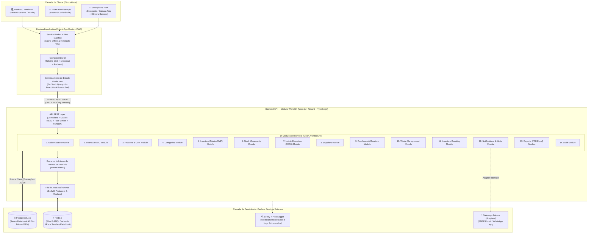
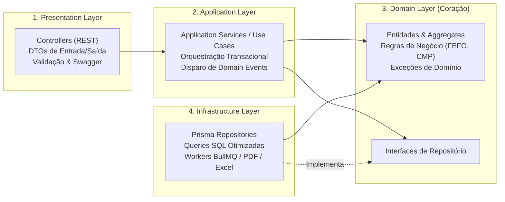

# 05. Arquitetura de Software e Stack Tecnológica

**Projeto:** Japa em Casa — Sistema Profissional de Gestão de Estoque para Restaurantes  
**Padrão Arquitetural:** Monólito Modular (*Modular Monolith*) com Clean Architecture Pragmática e Arquitetura Orientada a Eventos Internos (*Domain Events*).

---

## 1. Visão Geral e Justificativa Arquitetural

### 1.1. Por que Monólito Modular (e não Microsserviços)?
Para sistemas de gestão empresarial (ERP) de estoque e custos, a consistência transacional (ACID) entre **Recebimento de Compras -> Lotes -> Movimentações -> Saldo Físico -> Recálculo de Custo Médio Ponderado (CMP)** é crítica.
- Adotar microsserviços distribuídos na primeira versão introduziria complexidade acidental severa (transações distribuídas Saga/2PC, latência de rede entre serviços, sobrecarga de infraestrutura DevOps e eventual consistency onde o saldo precisa ser imediatamente consistente).
- O **Monólito Modular** em **NestJS** oferece o melhor dos dois mundos:
  1. **Fronteiras de Domínio Rígidas:** Código organizado em 14 módulos independentes e desacoplados.
  2. **Transações ACID Locais:** Operações críticas executam em uma única transação PostgreSQL com garantia total de integridade.
  3. **Evolução Futura Simples:** Como os módulos se comunicam por interfaces claras e Eventos de Domínio (`EventEmitter2` / `BullMQ`), qualquer módulo (ex: `ReportsModule` ou `NotificationsModule`) pode ser extraído para um serviço independente no futuro sem reescrever regras de negócio.

---

## 2. Diagrama Geral da Arquitetura do Sistema

---

## 3. Arquitetura Interna de Cada Módulo (Clean Architecture Pragmática)

Dentro de cada um dos 14 módulos do Backend, aplicamos a separação de responsabilidades em **4 camadas concêntricas**, evitando abstrações inúteis (como mapeadores redundantes onde não há lógica) e concentrando o rigor no **Domínio**:

1. **Controllers (Presentation):** Recebem a requisição HTTP, validam o payload via DTOs, verificam permissões via `@RequirePermissions('...')`, chamam o Application Service e retornam a resposta padronizada. Não contêm nenhuma regra de negócio.
2. **Application Services (Use Cases):** Orquestram o fluxo do caso de uso, abrem transações (`UnitOfWork` via Prisma Interactive Transactions), invocam entidades/serviços de domínio e publicam eventos internos.
3. **Domain (Entidades e Serviços de Domínio):** Onde residem cálculos críticos e puros (Cálculo do CMP, Seleção de Lotes FEFO, Validação de Limites de Estoque, Conversão de Unidades). Totalmente testável com testes unitários rápidos (Jest) sem depender de banco de dados.
4. **Repositories & Infrastructure:** Implementação concreta de acesso ao PostgreSQL via Prisma ORM, geração de arquivos PDF/Excel, filas Redis/BullMQ e adaptadores de notificação.

---

## 4. Relacionamento e Comunicação entre os 14 Módulos

Para evitar acoplamento circular (*Spaghetti Code*) entre os módulos, a comunicação segue duas regras claras:
1. **Consultas e Validações Síncronas:** Um módulo de nível operacional (ex: `StockMovementsModule`) pode consultar interfaces públicas exportadas por módulos base (`ProductsModule`, `LotsModule`, `InventoryModule`) dentro da mesma transação de banco de dados.
2. **Efeitos Colaterais Pós-Transação (Eventos de Domínio):** Quando uma movimentação é concluída, o `StockMovementsModule` **não precisa conhecer** a implementação interna de Alertas, Relatórios ou Auditoria. Ele publica um evento de domínio (`stock.movement.completed`), que é escutado por:
   - `NotificationsModule`: Avalia se o novo saldo atingiu o Ponto de Reposição, Estoque Mínimo ou Estoque de Segurança e cria/resolve alertas.
   - `PurchasesModule`: Atualiza a fila de "Sugestões Automáticas de Compra".
   - `AuditModule`: Persiste o registro de auditoria.
   - `ReportsModule`: Invalida o cache do Dashboard no Redis para refletir os novos KPIs em tempo real.

---

## 5. Stack Tecnológica Detalhada e Justificativas Técnicas

### 5.1. Frontend (PWA)
| Tecnologia | Versão Recomendada | Papel no Sistema e Justificativa |
| :--- | :--- | :--- |
| **Next.js (App Router)** | 14.x / 15.x | Framework React corporativo com suporte a rotas otimizadas, Server/Client Components e suporte nativo a manifesto PWA (`manifest.ts`) e Service Workers (`@serwist/next`). |
| **React + TypeScript** | 18.x / 5.x | Tipagem estática rigorosa compartilhada (contratos de API) prevenindo erros de runtime em cálculos e formulários. |
| **Tailwind CSS + shadcn/ui** | 3.4+ | Sistema de design acessível (baseado em Radix UI), altamente customizável, com suporte a modo claro/escuro e excelente ergonomia em telas touch (tablets e celulares). |
| **TanStack Query (React Query)** | v5 | Gerenciamento de cache de servidor, invalidação automática pós-mutação, *optimistic updates* e suporte a persistência offline. |
| **React Hook Form + Zod** | 7.x / 3.x | Formulários performáticos (sem re-renderizações desnecessárias) com validação declarativa de esquemas no cliente idêntica à do servidor. |
| **Recharts** | 2.x | Biblioteca de gráficos declarativos e responsivos para o Dashboard Gerencial (evolução de CMV, consumo por categoria, perdas por motivo). |
| **html5-qrcode / ZXing** | Latest | Leitura de código de barras EAN-13/Code128 diretamente pela câmera do smartphone/tablet no recebimento e nas baixas. |

### 5.2. Backend
| Tecnologia | Versão Recomendada | Papel no Sistema e Justificativa |
| :--- | :--- | :--- |
| **Node.js (LTS) + TypeScript** | 20.x LTS / 5.x | Alta performance de I/O, ecossistema maduro e compartilhamento de linguagem com o frontend. |
| **NestJS** | 10.x | Framework backend padrão ouro para arquitetura modular em TypeScript, com Injeção de Dependência nativa, Guards RBAC, Interceptors, Pipes de validação e integração OpenAPI. |
| **Swagger / OpenAPI** | 7.x (`@nestjs/swagger`) | Documentação interativa automática de todos os endpoints REST, DTOs e códigos de erro HTTP. |
| **Passport + JWT + Argon2** | Latest | Autenticação stateless via JWT (Access Token de 15m) + Refresh Token rotativo em banco/Redis e hashing de senhas com `argon2id` (vencedor da Password Hashing Competition). |
| **Decimal.js** | 10.x | Aritmética decimal de precisão arbitrária no backend para evitar erros de ponto flutuante IEEE 754 (ex: `0.1 + 0.2 !== 0.3`) em quantidades fracionadas e Custo Médio Ponderado. |

### 5.3. Banco de Dados, Filas e Infraestrutura
| Tecnologia | Versão Recomendada | Papel no Sistema e Justificativa |
| :--- | :--- | :--- |
| **PostgreSQL** | 16.x | SGBD relacional robusto, com suporte completo a transações ACID, `SELECT FOR UPDATE` (locks de linha), constraints `CHECK`, tipos `NUMERIC(12,4)` e `JSONB` para logs de auditoria. |
| **Prisma ORM** | 5.x / 6.x | ORM type-safe com *migrations* versionadas em SQL puro, prevenção nativa contra SQL Injection e suporte a Interactive Transactions e Raw SQL quando necessário para locks. |
| **Redis + BullMQ** | 7.x / 5.x | Processamento assíncrono em background (jobs diários de verificação de lotes vencidos, geração de relatórios pesados em PDF/Excel, envio futuro de notificações por e-mail/WhatsApp) e cache de KPIs. |
| **ExcelJS + PDFKit (ou Puppeteer)** | Latest | Geração nativa no servidor dos 13 relatórios gerenciais em `.xlsx` e `.pdf` com formatação profissional. |
| **Docker + Docker Compose** | Latest | Padronização total dos ambientes de desenvolvimento, homologação e produção (containers isolados para `frontend`, `backend`, `postgres` e `redis`). |
| **GitHub Actions** | CI/CD | Pipeline automatizado de Lint, Typecheck, Testes Unitários (Jest), Testes de Integração (Supertest), Testes E2E (Playwright) e build de imagens Docker. |
| **Pino + Sentry** | Latest | Logs estruturados em JSON de baixíssimo overhead (Pino) com correlação de Request ID e rastreamento proativo de exceções em tempo real (Sentry). |
