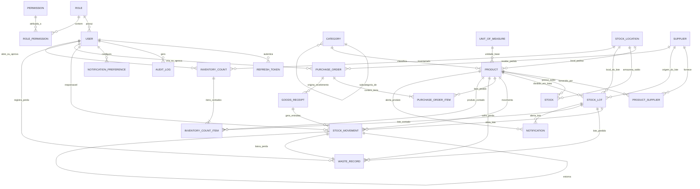

# 06. Modelagem do Banco de Dados (DER, Modelo Lógico, Índices e Prisma Schema)

**Projeto:** Japa em Casa — Sistema Profissional de Gestão de Estoque para Restaurantes  
**SGBD:** PostgreSQL 16 + Prisma ORM  
**Nível de Normalização:** 3ª Forma Normal (3FN) com campos de snapshot contábil controlados para auditoria histórica.

---

## 1. Entidades Principais do Modelo de Dados

Além das **19 entidades principais sugeridas**, adicionamos **4 entidades associativas/operacionais essenciais** para garantir conversão de unidades, rotação segura de sessões e rastreabilidade do recebimento físico:

1. `User` (Usuários do sistema)
2. `Role` (Papéis de acesso: Admin, Gerente, Gestor, Estoquista)
3. `Permission` (Permissões granulares `module:action`)
4. `RolePermission` *(Associativa N:N entre Role e Permission)*
5. `RefreshToken` *(Controle de sessões ativas e revogação segura)*
6. `Category` (Categorias e Subcategorias hierárquicas via auto-relacionamento)
7. `UnitOfMeasure` (Unidades de medida: KG, G, L, ML, UN, CX, etc.)
8. `UnitConversion` *(Regras de conversão entre unidades de compra e unidade base)*
9. `StockLocation` (Locais de armazenamento: Câmara Fria, Estoque Seco, etc.)
10. `Product` (Cadastro mestre de insumos e parâmetros de estoque/validade)
11. `Supplier` (Cadastro de fornecedores)
12. `ProductSupplier` (Catálogo Produto x Fornecedor com unidade de compra e fator de conversão)
13. `Stock` (Saldo consolidado do Produto por Local de Armazenamento)
14. `StockLot` (Controle de Lotes e Datas de Validade para FEFO)
15. `StockMovement` (Livro-razão imutável de todas as entradas, saídas, transferências, ajustes e estornos)
16. `PurchaseOrder` (Cabeçalho de Pedidos de Compra)
17. `PurchaseOrderItem` (Itens do Pedido de Compra com controle de saldo recebido vs. solicitado)
18. `GoodsReceipt` *(Registro de Recebimento Físico / Nota Fiscal vinculado ao Pedido)*
19. `WasteRecord` (Registro detalhado de Perdas e Desperdícios com impacto financeiro)
20. `InventoryCount` (Sessão de Inventário Físico parcial ou completo)
21. `InventoryCountItem` (Itens contados no inventário, snapshot do sistema e divergências)
22. `Notification` (Central de Alertas com prioridade e status de leitura/resolução)
23. `NotificationPreference` *(Configuração de quais usuários/papéis recebem cada tipo de alerta)*
24. `AuditLog` (Trilha de auditoria imutável com payload JSONB `old_values` e `new_values`)

---

## 2. Diagrama Entidade-Relacionamento (DER)



---

## 3. Modelo Lógico Completo (Schema Prisma Comentado)

Abaixo está a definição formal do modelo lógico utilizando a sintaxe do **Prisma ORM para PostgreSQL**, contemplando tipos de dados exatos (`Decimal(12,4)` para quantidades e custos), chaves primárias UUIDv4, chaves estrangeiras e índices compostos de alta performance:

```prisma
// datasource e generator
datasource db {
  provider = "postgresql"
  url      = env("DATABASE_URL")
}

generator client {
  provider = "prisma-client-js"
}

// ==========================================
// ENUMS DO DOMÍNIO
// ==========================================

enum StorageCondition {
  AMBIENT       // Temperatura ambiente (Estoque Seco)
  REFRIGERATED  // Refrigerado (0°C a 7°C - Câmara Resfriados)
  FROZEN        // Congelado (<= -12°C a -18°C - Freezer)
}

enum LotStatus {
  ACTIVE        // Disponível para uso (desde que expirationDate >= hoje)
  DEPLETED      // Saldo zerado por consumo normal
  EXPIRED       // Vencido (bloqueado para consumo normal)
  QUARANTINED   // Bloqueado preventivamente para averiguação sanitária
}

enum MovementType {
  ENTRADA_COMPRA
  ENTRADA_DEVOLUCAO
  SAIDA_PRODUCAO
  SAIDA_CONSUMO
  SAIDA_PERDA
  SAIDA_VENCIMENTO
  AJUSTE_INVENTARIO
  TRANSFERENCIA
  ESTORNO
}

enum PurchaseOrderStatus {
  RASCUNHO
  AGUARDANDO_APROVACAO
  APROVADO
  ENVIADO_FORNECEDOR
  PARCIALMENTE_RECEBIDO
  RECEBIDO
  CANCELADO
}

enum WasteReason {
  VENCIMENTO
  DETERIORACAO
  ARMAZENAMENTO_INADEQUADO
  ERRO_MANIPULACAO
  EXCESSO_PRODUCAO
  DANOS_TRANSPORTE
  OUTROS
}

enum InventoryStatus {
  ABERTO
  EM_CONTAGEM
  AGUARDANDO_APROVACAO
  APROVADO_AJUSTADO
  CANCELADO
}

enum AlertPriority {
  CRITICO
  ALTO
  MEDIO
  INFORMATIVO
}

enum AlertType {
  OUT_OF_STOCK
  BELOW_SAFETY_STOCK
  BELOW_MIN_STOCK
  REORDER_POINT_REACHED
  ABOVE_MAX_STOCK
  LOT_EXPIRED
  LOT_EXPIRING_SOON
  ABNORMAL_CONSUMPTION
  INVENTORY_DIVERGENCE
}

// ==========================================
// 1. USUÁRIOS, PAPÉIS E PERMISSÕES (RBAC)
// ==========================================

model Role {
  id          String           @id @default(uuid()) @db.Uuid
  code        String           @unique @db.VarChar(50) // ADMIN, GENERAL_MANAGER, STOCK_MANAGER, STOCK_CLERK
  name        String           @db.VarChar(100)
  description String?          @db.Text
  isSystem    Boolean          @default(false) @map("is_system")
  createdAt   DateTime         @default(now()) @map("created_at")
  updatedAt   DateTime         @updatedAt @map("updated_at")

  users       User[]
  permissions RolePermission[]

  @@map("roles")
}

model Permission {
  id          String           @id @default(uuid()) @db.Uuid
  slug        String           @unique @db.VarChar(100) // ex: "products:write", "purchases:approve"
  module      String           @db.VarChar(50)
  description String           @db.VarChar(255)

  roles       RolePermission[]

  @@map("permissions")
}

model RolePermission {
  roleId       String     @map("role_id") @db.Uuid
  permissionId String     @map("permission_id") @db.Uuid

  role         Role       @relation(fields: [roleId], references: [id], onDelete: Cascade)
  permission   Permission @relation(fields: [permissionId], references: [id], onDelete: Cascade)

  @@id([roleId, permissionId])
  @@map("role_permissions")
}

model User {
  id                  String    @id @default(uuid()) @db.Uuid
  name                String    @db.VarChar(150)
  email               String    @unique @db.VarChar(150)
  passwordHash        String    @map("password_hash") @db.VarChar(255)
  phone               String?   @db.VarChar(20)
  roleId              String    @map("role_id") @db.Uuid
  isActive            Boolean   @default(true) @map("is_active")
  failedLoginAttempts Int       @default(0) @map("failed_login_attempts")
  lockedUntil         DateTime? @map("locked_until")
  lastLoginAt         DateTime? @map("last_login_at")
  createdAt           DateTime  @default(now()) @map("created_at")
  updatedAt           DateTime  @updatedAt @map("updated_at")

  role                Role                     @relation(fields: [roleId], references: [id])
  refreshTokens       RefreshToken[]
  movements           StockMovement[]
  createdPurchases    PurchaseOrder[]          @relation("PurchaseCreator")
  approvedPurchases   PurchaseOrder[]          @relation("PurchaseApprover")
  goodsReceipts       GoodsReceipt[]
  wasteRecords        WasteRecord[]
  openedInventories   InventoryCount[]         @relation("InventoryOpener")
  approvedInventories InventoryCount[]         @relation("InventoryApprover")
  countedItems        InventoryCountItem[]
  alertPreferences    NotificationPreference[]
  auditLogs           AuditLog[]

  @@index([email])
  @@index([roleId, isActive])
  @@map("users")
}

model RefreshToken {
  id        String    @id @default(uuid()) @db.Uuid
  userId    String    @map("user_id") @db.Uuid
  tokenHash String    @unique @map("token_hash") @db.VarChar(255)
  userAgent String?   @map("user_agent") @db.VarChar(255)
  ipAddress String?   @map("ip_address") @db.VarChar(45)
  expiresAt DateTime  @map("expires_at")
  revokedAt DateTime? @map("revoked_at")
  createdAt DateTime  @default(now()) @map("created_at")

  user      User      @relation(fields: [userId], references: [id], onDelete: Cascade)

  @@index([userId, revokedAt])
  @@map("refresh_tokens")
}

// ==========================================
// 2. CATÁLOGO: CATEGORIAS, UNIDADES, LOCAIS E PRODUTOS
// ==========================================

model Category {
  id          String     @id @default(uuid()) @db.Uuid
  name        String     @db.VarChar(100)
  slug        String     @unique @db.VarChar(120)
  description String?    @db.Text
  parentId    String?    @map("parent_id") @db.Uuid
  isActive    Boolean    @default(true) @map("is_active")
  createdAt   DateTime   @default(now()) @map("created_at")
  updatedAt   DateTime   @updatedAt @map("updated_at")

  parent      Category?  @relation("CategoryHierarchy", fields: [parentId], references: [id])
  children    Category[] @relation("CategoryHierarchy")
  products    Product[]

  @@index([parentId])
  @@map("categories")
}

model UnitOfMeasure {
  id            String   @id @default(uuid()) @db.Uuid
  code          String   @unique @db.VarChar(15) // KG, G, L, ML, UN, CX, FD, PCT
  name          String   @db.VarChar(60)         // Quilograma, Grama, Litro...
  allowFraction Boolean  @default(true) @map("allow_fraction")
  createdAt     DateTime @default(now()) @map("created_at")

  products          Product[]
  supplierCatalog   ProductSupplier[]

  @@map("units_of_measure")
}

model StockLocation {
  id             String           @id @default(uuid()) @db.Uuid
  code           String           @unique @db.VarChar(30) // CAM-01, EST-SECO-01, SUSHIBAR
  name           String           @db.VarChar(100)
  description    String?          @db.Text
  condition      StorageCondition @default(AMBIENT)
  minTempCelsius Decimal?         @map("min_temp_celsius") @db.Decimal(5, 2)
  maxTempCelsius Decimal?         @map("max_temp_celsius") @db.Decimal(5, 2)
  isActive       Boolean          @default(true) @map("is_active")
  createdAt      DateTime         @default(now()) @map("created_at")
  updatedAt      DateTime         @updatedAt @map("updated_at")

  defaultProducts   Product[]
  stocks            Stock[]
  lots              StockLot[]
  originMovements   StockMovement[]  @relation("OriginLocation")
  destMovements     StockMovement[]  @relation("DestinationLocation")
  inventoryCounts   InventoryCount[]

  @@map("stock_locations")
}

model Product {
  id                         String           @id @default(uuid()) @db.Uuid
  sku                        String           @unique @db.VarChar(50)
  barcode                    String?          @unique @db.VarChar(60)
  name                       String           @db.VarChar(150)
  description                String?          @db.Text
  brand                      String?          @db.VarChar(100)
  categoryId                 String           @map("category_id") @db.Uuid
  baseUnitId                 String           @map("base_unit_id") @db.Uuid
  primarySupplierId          String?          @map("primary_supplier_id") @db.Uuid
  defaultLocationId          String?          @map("default_location_id") @db.Uuid

  // Custos (R$)
  lastUnitCost               Decimal          @default(0) @map("last_unit_cost") @db.Decimal(12, 4)
  averageWeightedCost        Decimal          @default(0) @map("average_weighted_cost") @db.Decimal(12, 4) // CMP

  // Níveis e Saldos Consolidados (na Unidade Base)
  currentStock               Decimal          @default(0) @map("current_stock") @db.Decimal(12, 4)
  reservedStock              Decimal          @default(0) @map("reserved_stock") @db.Decimal(12, 4)
  minStock                   Decimal          @default(0) @map("min_stock") @db.Decimal(12, 4)
  maxStock                   Decimal          @default(0) @map("max_stock") @db.Decimal(12, 4)
  safetyStock                Decimal          @default(0) @map("safety_stock") @db.Decimal(12, 4)
  reorderPoint               Decimal          @default(0) @map("reorder_point") @db.Decimal(12, 4)

  // Perecibilidade, Refrigeração e Rendimento
  isPerishable               Boolean          @default(true) @map("is_perishable")
  defaultShelfLifeDays       Int?             @map("default_shelf_life_days")
  minAcceptableShelfLifeDays Int?             @map("min_acceptable_shelf_life_days")
  afterOpenShelfLifeDays     Int?             @map("after_open_shelf_life_days")
  storageCondition           StorageCondition @default(AMBIENT) @map("storage_condition")
  yieldPercentage            Decimal          @default(100.00) @map("yield_percentage") @db.Decimal(5, 2)

  isActive                   Boolean          @default(true) @map("is_active")
  createdAt                  DateTime         @default(now()) @map("created_at")
  updatedAt                  DateTime         @updatedAt @map("updated_at")

  category                   Category              @relation(fields: [categoryId], references: [id])
  baseUnit                   UnitOfMeasure         @relation(fields: [baseUnitId], references: [id])
  primarySupplier            Supplier?             @relation("PrimarySupplier", fields: [primarySupplierId], references: [id])
  defaultLocation            StockLocation?        @relation(fields: [defaultLocationId], references: [id])
  suppliers                  ProductSupplier[]
  stocks                     Stock[]
  lots                       StockLot[]
  movements                  StockMovement[]
  purchaseItems              PurchaseOrderItem[]
  wasteRecords               WasteRecord[]
  inventoryItems             InventoryCountItem[]
  notifications              Notification[]

  @@index([categoryId, isActive])
  @@index([name])
  @@index([currentStock, minStock, reorderPoint])
  @@map("products")
}

// ==========================================
// 3. FORNECEDORES E CATÁLOGO DE FORNECIMENTO
// ==========================================

model Supplier {
  id                  String   @id @default(uuid()) @db.Uuid
  companyName         String   @map("company_name") @db.VarChar(150) // Razão Social
  tradeName           String?  @map("trade_name") @db.VarChar(150)   // Nome Fantasia
  documentNumber      String   @unique @map("document_number") @db.VarChar(20) // CNPJ ou CPF
  contactName         String?  @map("contact_name") @db.VarChar(100)
  phone               String   @db.VarChar(25)
  email               String?  @db.VarChar(150)
  addressStreet       String?  @map("address_street") @db.VarChar(150)
  addressNumber       String?  @map("address_number") @db.VarChar(20)
  addressComplement   String?  @map("address_complement") @db.VarChar(100)
  addressDistrict     String?  @map("address_district") @db.VarChar(100)
  addressCity         String?  @map("address_city") @db.VarChar(100)
  addressState        String?  @map("address_state") @db.Char(2)
  addressZipCode      String?  @map("address_zip_code") @db.VarChar(10)
  paymentTerms        String?  @map("payment_terms") @db.VarChar(150) // ex: "28 DDL Boleto", "PIX à vista"
  averageLeadTimeDays Int      @default(2) @map("average_lead_time_days")
  notes               String?  @db.Text
  isActive            Boolean  @default(true) @map("is_active")
  createdAt           DateTime @default(now()) @map("created_at")
  updatedAt           DateTime @updatedAt @map("updated_at")

  primaryForProducts Product[]         @relation("PrimarySupplier")
  productCatalog     ProductSupplier[]
  lots               StockLot[]
  purchaseOrders     PurchaseOrder[]

  @@index([companyName])
  @@index([isActive])
  @@map("suppliers")
}

model ProductSupplier {
  id                 String        @id @default(uuid()) @db.Uuid
  productId          String        @map("product_id") @db.Uuid
  supplierId         String        @map("supplier_id") @db.Uuid
  supplierProductSku String?       @map("supplier_product_sku") @db.VarChar(60)
  purchaseUnitId     String        @map("purchase_unit_id") @db.Uuid
  conversionFactor   Decimal       @default(1.0000) @map("conversion_factor") @db.Decimal(12, 4) // 1 Unid Compra = X Unid Base
  lastNegotiatedCost Decimal       @default(0) @map("last_negotiated_cost") @db.Decimal(12, 4)
  leadTimeDays       Int?          @map("lead_time_days")
  isPreferred        Boolean       @default(false) @map("is_preferred")
  updatedAt          DateTime      @updatedAt @map("updated_at")

  product            Product       @relation(fields: [productId], references: [id], onDelete: Cascade)
  supplier           Supplier      @relation(fields: [supplierId], references: [id], onDelete: Cascade)
  purchaseUnit       UnitOfMeasure @relation(fields: [purchaseUnitId], references: [id])

  @@unique([productId, supplierId])
  @@map("product_suppliers")
}

// ==========================================
// 4. ESTOQUE, LOTES (FEFO) E MOVIMENTAÇÕES
// ==========================================

model Stock {
  id               String        @id @default(uuid()) @db.Uuid
  productId        String        @map("product_id") @db.Uuid
  locationId       String        @map("location_id") @db.Uuid
  quantity         Decimal       @default(0) @db.Decimal(12, 4)
  reservedQuantity Decimal       @default(0) @map("reserved_quantity") @db.Decimal(12, 4)
  updatedAt        DateTime      @updatedAt @map("updated_at")

  product          Product       @relation(fields: [productId], references: [id])
  location         StockLocation @relation(fields: [locationId], references: [id])

  @@unique([productId, locationId])
  @@map("stocks")
}

model StockLot {
  id                String        @id @default(uuid()) @db.Uuid
  productId         String        @map("product_id") @db.Uuid
  lotNumber         String        @map("lot_number") @db.VarChar(80)
  supplierId        String?       @map("supplier_id") @db.Uuid
  locationId        String        @map("location_id") @db.Uuid
  receivedAt        DateTime      @default(now()) @map("received_at")
  manufacturedDate  DateTime?     @map("manufactured_date") @db.Date
  expirationDate    DateTime      @map("expiration_date") @db.Date
  isOpened          Boolean       @default(false) @map("is_opened")
  openedAt          DateTime?     @map("opened_at")
  receivedQuantity  Decimal       @map("received_quantity") @db.Decimal(12, 4)
  availableQuantity Decimal       @map("available_quantity") @db.Decimal(12, 4)
  unitCost          Decimal       @map("unit_cost") @db.Decimal(12, 4)
  status            LotStatus     @default(ACTIVE)
  createdAt         DateTime      @default(now()) @map("created_at")
  updatedAt         DateTime      @updatedAt @map("updated_at")

  product           Product              @relation(fields: [productId], references: [id])
  supplier          Supplier?            @relation(fields: [supplierId], references: [id])
  location          StockLocation        @relation(fields: [locationId], references: [id])
  movements         StockMovement[]
  wasteRecords      WasteRecord[]
  inventoryItems    InventoryCountItem[]
  notifications     Notification[]

  // Índice composto crucial para o algoritmo FEFO (First Expired, First Out)
  @@index([productId, status, expirationDate(sort: Asc), receivedAt(sort: Asc)], name: "idx_fefo_lookup")
  @@index([expirationDate, status])
  @@map("stock_lots")
}

model StockMovement {
  id                    String         @id @default(uuid()) @db.Uuid
  productId             String         @map("product_id") @db.Uuid
  lotId                 String?        @map("lot_id") @db.Uuid
  type                  MovementType
  quantity              Decimal        @db.Decimal(12, 4) // Sempre positivo; a direção é dada pelo MovementType
  unitCost              Decimal        @map("unit_cost") @db.Decimal(12, 4)
  totalCost             Decimal        @map("total_cost") @db.Decimal(14, 4)
  previousBalance       Decimal        @map("previous_balance") @db.Decimal(12, 4)
  resultingBalance      Decimal        @map("resulting_balance") @db.Decimal(12, 4)
  originLocationId      String?        @map("origin_location_id") @db.Uuid
  destinationLocationId String?        @map("destination_location_id") @db.Uuid
  costCenter            String?        @map("cost_center") @db.VarChar(80) // ex: "Sushibar", "Cozinha Quente"
  userId                String         @map("user_id") @db.Uuid
  reason                String         @db.VarChar(255)
  referenceDocument     String?        @map("reference_document") @db.VarChar(100) // NF, Pedido, ID Inventário
  goodsReceiptId        String?        @map("goods_receipt_id") @db.Uuid
  isReversed            Boolean        @default(false) @map("is_reversed")
  reversedFromId        String?        @unique @map("reversed_from_id") @db.Uuid
  createdAt             DateTime       @default(now()) @map("created_at")

  product               Product        @relation(fields: [productId], references: [id])
  lot                   StockLot?      @relation(fields: [lotId], references: [id])
  originLocation        StockLocation? @relation("OriginLocation", fields: [originLocationId], references: [id])
  destinationLocation   StockLocation? @relation("DestinationLocation", fields: [destinationLocationId], references: [id])
  user                  User           @relation(fields: [userId], references: [id])
  goodsReceipt          GoodsReceipt?  @relation(fields: [goodsReceiptId], references: [id])
  reversedFrom          StockMovement? @relation("MovementReversal", fields: [reversedFromId], references: [id])
  reversedBy            StockMovement? @relation("MovementReversal")
  wasteRecord           WasteRecord?

  @@index([productId, createdAt(sort: Desc)])
  @@index([type, createdAt(sort: Desc)])
  @@index([userId, createdAt(sort: Desc)])
  @@map("stock_movements")
}

// ==========================================
// 5. COMPRAS E RECEBIMENTO DE MERCADORIAS
// ==========================================

model PurchaseOrder {
  id                   String              @id @default(uuid()) @db.Uuid
  code                 String              @unique @db.VarChar(30) // ex: "PO-2026-0001"
  supplierId           String              @map("supplier_id") @db.Uuid
  status               PurchaseOrderStatus @default(RASCUNHO)
  expectedDeliveryDate DateTime?           @map("expected_delivery_date") @db.Date
  paymentTerms         String?             @map("payment_terms") @db.VarChar(150)
  totalAmount          Decimal             @default(0) @map("total_amount") @db.Decimal(14, 2)
  notes                String?             @db.Text
  createdById          String              @map("created_by_id") @db.Uuid
  approvedById         String?             @map("approved_by_id") @db.Uuid
  approvedAt           DateTime?           @map("approved_at")
  createdAt            DateTime            @default(now()) @map("created_at")
  updatedAt            DateTime            @updatedAt @map("updated_at")

  supplier             Supplier            @relation(fields: [supplierId], references: [id])
  createdBy            User                @relation("PurchaseCreator", fields: [createdById], references: [id])
  approvedBy           User?               @relation("PurchaseApprover", fields: [approvedById], references: [id])
  items                PurchaseOrderItem[]
  receipts             GoodsReceipt[]

  @@index([status, createdAt(sort: Desc)])
  @@index([supplierId, createdAt(sort: Desc)])
  @@map("purchase_orders")
}

model PurchaseOrderItem {
  id                String        @id @default(uuid()) @db.Uuid
  purchaseOrderId   String        @map("purchase_order_id") @db.Uuid
  productId         String        @map("product_id") @db.Uuid
  orderedQuantity   Decimal       @map("ordered_quantity") @db.Decimal(12, 4) // Na unidade base ou convertida
  receivedQuantity  Decimal       @default(0) @map("received_quantity") @db.Decimal(12, 4)
  conversionFactor  Decimal       @default(1.0000) @map("conversion_factor") @db.Decimal(12, 4)
  negotiatedUnitCost Decimal      @map("negotiated_unit_cost") @db.Decimal(12, 4)
  totalItemCost     Decimal       @map("total_item_cost") @db.Decimal(14, 2)

  purchaseOrder     PurchaseOrder @relation(fields: [purchaseOrderId], references: [id], onDelete: Cascade)
  product           Product       @relation(fields: [productId], references: [id])

  @@index([purchaseOrderId])
  @@map("purchase_order_items")
}

model GoodsReceipt {
  id                String          @id @default(uuid()) @db.Uuid
  purchaseOrderId   String          @map("purchase_order_id") @db.Uuid
  invoiceNumber     String          @map("invoice_number") @db.VarChar(60) // Número da NF
  invoiceSeries     String?         @map("invoice_series") @db.VarChar(10)
  receivedAt        DateTime        @default(now()) @map("received_at")
  receivedById      String          @map("received_by_id") @db.Uuid
  hasDivergence     Boolean         @default(false) @map("has_divergence")
  divergenceNotes   String?         @map("divergence_notes") @db.Text
  temperatureC      Decimal?        @map("temperature_c") @db.Decimal(5, 2)

  purchaseOrder     PurchaseOrder   @relation(fields: [purchaseOrderId], references: [id])
  receivedBy        User            @relation(fields: [receivedById], references: [id])
  movements         StockMovement[]

  @@index([purchaseOrderId])
  @@map("goods_receipts")
}

// ==========================================
// 6. PERDAS, DESPERDÍCIOS E INVENTÁRIO FÍSICO
// ==========================================

model WasteRecord {
  id                     String        @id @default(uuid()) @db.Uuid
  productId              String        @map("product_id") @db.Uuid
  lotId                  String?       @map("lot_id") @db.Uuid
  movementId             String        @unique @map("movement_id") @db.Uuid
  quantity               Decimal       @db.Decimal(12, 4)
  reason                 WasteReason
  notes                  String?       @db.Text
  unitCostAtWaste        Decimal       @map("unit_cost_at_waste") @db.Decimal(12, 4) // CMP no momento da perda
  estimatedFinancialLoss Decimal       @map("estimated_financial_loss") @db.Decimal(14, 2)
  reportedById           String        @map("reported_by_id") @db.Uuid
  occurredAt             DateTime      @default(now()) @map("occurred_at")

  product                Product       @relation(fields: [productId], references: [id])
  lot                    StockLot?     @relation(fields: [lotId], references: [id])
  movement               StockMovement @relation(fields: [movementId], references: [id])
  reportedBy             User          @relation(fields: [reportedById], references: [id])

  @@index([occurredAt(sort: Desc), reason])
  @@index([productId, occurredAt(sort: Desc)])
  @@map("waste_records")
}

model InventoryCount {
  id           String               @id @default(uuid()) @db.Uuid
  code         String               @unique @db.VarChar(30) // ex: "INV-2026-0012"
  title        String               @db.VarChar(150)
  isPartial    Boolean              @default(true) @map("is_partial")
  locationId   String?              @map("location_id") @db.Uuid
  status       InventoryStatus      @default(ABERTO)
  openedById   String               @map("opened_by_id") @db.Uuid
  approvedById String?              @map("approved_by_id") @db.Uuid
  openedAt     DateTime             @default(now()) @map("opened_at")
  closedAt     DateTime?            @map("closed_at")
  notes        String?              @db.Text

  location     StockLocation?       @relation(fields: [locationId], references: [id])
  openedBy     User                 @relation("InventoryOpener", fields: [openedById], references: [id])
  approvedBy   User?                @relation("InventoryApprover", fields: [approvedById], references: [id])
  items        InventoryCountItem[]

  @@index([status, openedAt(sort: Desc)])
  @@map("inventory_counts")
}

model InventoryCountItem {
  id                  String         @id @default(uuid()) @db.Uuid
  inventoryCountId    String         @map("inventory_count_id") @db.Uuid
  productId           String         @map("product_id") @db.Uuid
  lotId               String?        @map("lot_id") @db.Uuid
  systemQuantity      Decimal        @map("system_quantity") @db.Decimal(12, 4) // Snapshot oculto no modo cego
  countedQuantity     Decimal?       @map("counted_quantity") @db.Decimal(12, 4)
  divergenceQuantity  Decimal?       @map("divergence_quantity") @db.Decimal(12, 4)
  unitCostSnapshot    Decimal        @map("unit_cost_snapshot") @db.Decimal(12, 4)
  financialDivergence Decimal?       @map("financial_divergence") @db.Decimal(14, 2)
  justification       String?        @db.VarChar(255)
  countedById         String?        @map("counted_by_id") @db.Uuid
  countedAt           DateTime?      @map("counted_at")

  inventoryCount      InventoryCount @relation(fields: [inventoryCountId], references: [id], onDelete: Cascade)
  product             Product        @relation(fields: [productId], references: [id])
  lot                 StockLot?      @relation(fields: [lotId], references: [id])
  countedBy           User?          @relation(fields: [countedById], references: [id])

  @@index([inventoryCountId])
  @@map("inventory_count_items")
}

// ==========================================
// 7. NOTIFICAÇÕES, ALERTAS E AUDITORIA
// ==========================================

model Notification {
  id         String        @id @default(uuid()) @db.Uuid
  type       AlertType
  priority   AlertPriority
  title      String        @db.VarChar(150)
  message    String        @db.Text
  productId  String?       @map("product_id") @db.Uuid
  lotId      String?       @map("lot_id") @db.Uuid
  isRead     Boolean       @default(false) @map("is_read")
  isResolved Boolean       @default(false) @map("is_resolved")
  resolvedAt DateTime?     @map("resolved_at")
  createdAt  DateTime      @default(now()) @map("created_at")

  product    Product?      @relation(fields: [productId], references: [id])
  lot        StockLot?     @relation(fields: [lotId], references: [id])

  @@index([isResolved, priority, createdAt(sort: Desc)])
  @@index([productId, type, isResolved])
  @@map("notifications")
}

model NotificationPreference {
  id             String        @id @default(uuid()) @db.Uuid
  userId         String        @map("user_id") @db.Uuid
  alertType      AlertType     @map("alert_type")
  inAppEnabled   Boolean       @default(true) @map("in_app_enabled")
  emailEnabled   Boolean       @default(false) @map("email_enabled")
  whatsappEnabled Boolean      @default(false) @map("whatsapp_enabled")

  user           User          @relation(fields: [userId], references: [id], onDelete: Cascade)

  @@unique([userId, alertType])
  @@map("notification_preferences")
}

model AuditLog {
  id         String   @id @default(uuid()) @db.Uuid
  userId     String?  @map("user_id") @db.Uuid
  action     String   @db.VarChar(100) // ex: "STOCK_MOVEMENT_REVERSED", "PURCHASE_APPROVED"
  entityType String   @map("entity_type") @db.VarChar(60)
  entityId   String   @map("entity_id") @db.VarChar(60)
  oldValues  Json?    @map("old_values") @db.JsonB
  newValues  Json?    @map("new_values") @db.JsonB
  ipAddress  String?  @map("ip_address") @db.VarChar(45)
  userAgent  String?  @map("user_agent") @db.VarChar(255)
  createdAt  DateTime @default(now()) @map("created_at")

  user       User?    @relation(fields: [userId], references: [id])

  @@index([entityType, entityId, createdAt(sort: Desc)])
  @@index([userId, createdAt(sort: Desc)])
  @@map("audit_logs")
}
```

---

## 4. Estratégia de Índices e Constraints de Integridade

1. **Índice Composto FEFO (`idx_fefo_lookup`):** Criado em `stock_lots (product_id, status, expiration_date ASC, received_at ASC)`. Permite que o algoritmo de baixa FEFO encontre o lote mais próximo do vencimento em menos de **2 milissegundos**, mesmo que o restaurante acumule centenas de milhares de lotes históricos.
2. **Constraints `CHECK` Nativas via Migration SQL:**
   Na migration inicial do PostgreSQL, são adicionadas as restrições físicas:
   ```sql
   ALTER TABLE stocks ADD CONSTRAINT chk_stocks_non_negative CHECK (quantity >= 0 AND reserved_quantity >= 0);
   ALTER TABLE stock_lots ADD CONSTRAINT chk_lots_non_negative CHECK (available_quantity >= 0 AND received_quantity > 0);
   ALTER TABLE stock_movements ADD CONSTRAINT chk_movements_positive_qty CHECK (quantity > 0);
   ALTER TABLE products ADD CONSTRAINT chk_stock_thresholds CHECK (safety_stock >= 0 AND min_stock >= safety_stock);
   ```
