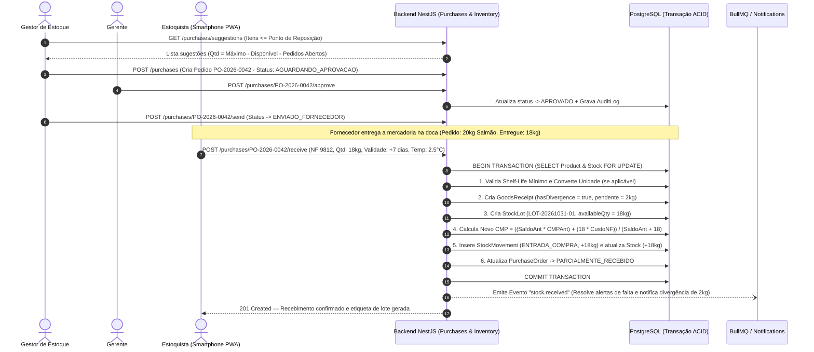
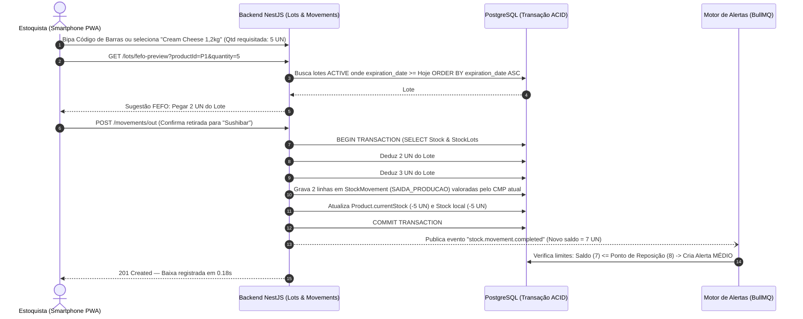
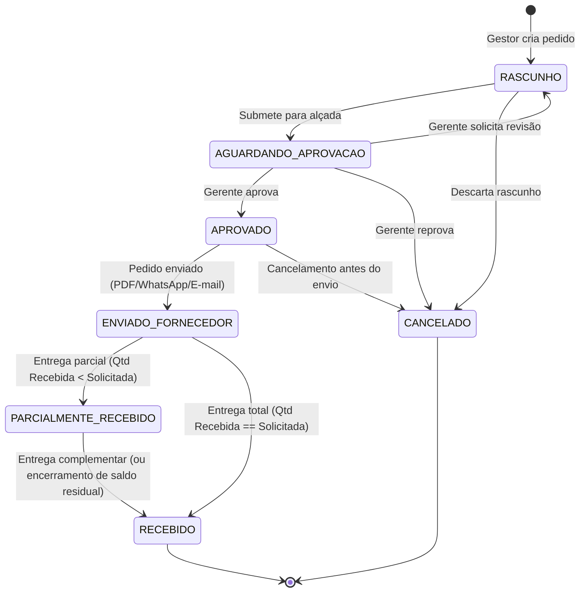

# 08. Fluxos das Principais Operações de Estoque e Definição de Telas (UX/UI)

**Projeto:** Japa em Casa — Sistema Profissional de Gestão de Estoque para Restaurantes  
**Módulo:** Modelagem Dinâmica de Processos e Arquitetura da Informação (UX/UI PWA)

---

## 1. Fluxos Operacionais Críticos (Diagramas de Sequência e Estados)

### 1.1. Fluxo de Compra, Recebimento com Divergência, Criação de Lote e Recálculo de CMP

Este fluxo demonstra o ciclo completo desde a detecção automática de Ponto de Reposição até o recebimento físico na doca do restaurante:

---

### 1.2. Fluxo de Saída para Produção com Alocação Automática FEFO Multi-Lote

Demonstra como o sistema garante que o insumo que vence primeiro saia primeiro, protegendo contra estoque negativo e produtos vencidos:

---

### 1.3. Máquina de Estados do Ciclo de Vida do Pedido de Compra

---

## 2. Definição das Telas, Mapa de Navegação e Experiência do Usuário (UX/UI)

A interface segue os padrões de sistemas SaaS e ERPs modernos, utilizando **Tailwind CSS + shadcn/ui**, tipografia de alta legibilidade (`Inter` / `Geist Sans` e `JetBrains Mono` para números/SKUs/valores monetários) e semântica de cores clara:
- 🔴 **Vermelho (`rose-600`):** Crítico — Produto Esgotado, Abaixo da Segurança ou Lote Vencido.
- 🟠 **Laranja (`amber-600`):** Alto — Abaixo do Mínimo ou Vencendo em $\le 7$ dias.
- 🟡 **Amarelo (`yellow-500`):** Médio — Atingiu Ponto de Reposição ou Vencendo em 15-30 dias.
- 🟢 **Verde (`emerald-600`):** Normal — Estoque Saudável e Lotes dentro da validade.
- 🔵 **Azul (`sky-600`):** Informativo — Acima do Estoque Máximo ou Em Pedido de Compra.

### 2.1. Adaptação Responsiva (Desktop vs. Tablet vs. Smartphone PWA)

| Dispositivo | Estrutura de Navegação | Foco de Operação |
| :--- | :--- | :--- |
| **Desktop / Notebook (`>= 1024px`)** | **Sidebar Lateral Fixa** (recolhível) + **Topbar** com Busca Global (`Ctrl+K`), Seletor de Local, Sino de Alertas e Perfil. | Visão densa em tabelas multifiltro, gráficos analíticos do Dashboard, geração de Pedidos de Compra, auditoria de Inventários e exportação de Relatórios. |
| **Tablet (`768px - 1023px`)** | **Sidebar Compacta (Ícones)** expansível ao toque + botões com área de toque mínima de `48x48px`. | Conferência de mercadorias na bancada, supervisão da cozinha, aprovação rápida de pedidos pelo Gerente. |
| **Smartphone PWA (`< 768px`)** | **Bottom Navigation Bar (5 ações principais)** + Botão Flutuante Central (**Ação Rápida: Bipar / Baixar / Receber**). Tabelas convertem-se automaticamente em **Cards de Leitura Rápida**. | Uso com uma mão pelo Estoquista dentro da Câmara Fria ou Doca: Bipar código de barras pela câmera, confirmar retirada FEFO em 3 toques e registrar perdas. |

---

### 2.2. Catálogo Detalhado das Telas do Sistema

1. **Tela 01 — Login e Instalação PWA (`/login`)**
   - Autenticação limpa com e-mail e senha, feedback de tentativas e banner nativo *"Instalar Aplicativo Japa em Casa no seu dispositivo"* quando acessado via navegador compatível.

2. **Tela 02 — Dashboard Gerencial (`/`)**
   - **Faixa de Alertas Prioritários (Topo):** Banner expansível destacando ocorrências **Críticas** (ex: *"2 lotes vencidos aguardando descarte"* e *"Salmão Fresco atingiu Estoque de Segurança"*).
   - **Grid de 6 KPI Cards Principais:**
     1. Valor Financeiro Total do Estoque (`R$`);
     2. Total de Itens Cadastrados Ativos;
     3. Produtos Críticos / Sem Estoque (com link direto para filtro);
     4. Produtos Abaixo do Mínimo / Ponto de Reposição;
     5. Lotes Vencidos e Próximos do Vencimento (próximos 7 dias);
     6. Compras vs. Perdas Acumuladas no Mês (`R$`).
   - **Seção Gráfica (Recharts):**
     - Gráfico de Barras/Linhas: *Entradas vs. Consumo vs. Desperdício nos últimos 30 dias (R$)*;
     - Gráfico Donut: *Distribuição do Valor do Estoque por Categoria*;
     - Ranking Lado a Lado: *Top 5 Produtos de Maior Consumo* e *Top 5 Produtos com Maior Índice de Desperdício*.
   - **Timeline de Movimentações Recentes:** Últimas 10 operações em tempo real com usuário, horário, tipo e valor.

3. **Tela 03 — Catálogo e Gerenciamento de Produtos (`/produtos` e `/produtos/[id]`)**
   - **Listagem (`/produtos`):** Barra de pesquisa instantânea + botão de câmera para ler código de barras + filtros rápidos por Categoria, Condição Térmica (*Ambiente, Refrigerado, Congelado*) e Status de Saldo. Colunas: SKU, Produto, Categoria, Local Padrão, Saldo Disponível (com barra visual de progresso entre Mínimo e Máximo), CMP (`R$`), Status e Ações.
   - **Ficha Detalhada do Produto (`/produtos/[id]`):** Abas organizadas:
     - *Visão Geral e Parâmetros:* Estoque Atual, Disponível, Segurança, Mínimo, Ponto de Reposição, Máximo, Rendimento (%) e prazos de validade.
     - *Lotes Ativos (Ordem FEFO):* Lista dos lotes disponíveis na câmara/estoque com contagem regressiva de dias para vencer.
     - *Fornecedores e Conversões:* Fornecedores vinculados, unidades de compra e evolução histórica do custo de aquisição.
     - *Kardex (Extrato do Produto):* Histórico completo de entradas, saídas, ajustes e evolução do CMP daquele item.

4. **Tela 04 — Painel de Lotes e Controle de Validade (`/lotes-validade`)**
   - Visão estilo Kanban ou Tabela filtrada por abas de urgência: 🔴 **Vencidos (Bloqueados)** | 🟠 **Vencem em até 3 dias** | 🟡 **Vencem em 7 dias** | 🔵 **Vencem em 15/30 dias** | 🟢 **Todos os Lotes**.
   - Botão de ação rápida em lotes vencidos: *"Baixar por Vencimento (Gerar Registro de Perda)"*.
   - Botão de ação rápida em lotes fechados: *"Registrar Abertura / Fracionamento"* (recalcula validade pós-abertura).

5. **Tela 05 — Central de Movimentações e Operação Rápida Mobile (`/movimentacoes`)**
   - **Modo Operação Rápida (3 Passos para Estoquista):**
     - *Passo 1:* Escolher Tipo (`Saída Produção`, `Saída Consumo`, `Transferência`, `Devolução`) e Setor (*Sushibar*, *Cozinha Quente*, *Bar*).
     - *Passo 2:* Bipar código de barras ou selecionar produto + digitar quantidade. O card já mostra a **Alocação FEFO Automática** (ex: *"Retirar 4 kg do Lote #882 - Câmara Fria 01"*).
     - *Passo 3:* Confirmar com 1 toque.
   - **Histórico Auditável:** Tabela completa com botão *"Estornar Movimentação"* (visível apenas para Gestor/Gerente/Admin), que abre modal exigindo justificativa formal.

6. **Tela 06 — Gestão de Compras e Recebimento Físico (`/compras`)**
   - **Aba 1: Sugestão Inteligente de Reposição:** Tabela com todos os itens que atingiram o Ponto de Reposição ou Estoque Mínimo, já preenchida com a quantidade sugerida para atingir o Estoque Máximo. Com 1 clique em *"Gerar Pedidos de Compra por Fornecedor"*, o sistema agrupa os itens e cria os pedidos.
   - **Aba 2: Pedidos de Compra:** Controle do fluxo (`Rascunho` -> `Aguardando Aprovação` -> `Aprovado` -> `Enviado` -> `Parcialmente Recebido` -> `Recebido`).
   - **Aba 3: Conferência de Recebimento (Doca):** Tela otimizada para tablet/celular onde o recebedor digita a NF, confere item a item a quantidade entregue, informa Lote, Validade e Temperatura, visualiza alertas de divergência ou validade curta e confirma a entrada.

7. **Tela 07 — Gestão de Fornecedores (`/fornecedores`)**
   - Cadastro completo (CNPJ, contato, prazo médio de entrega, condições de pagamento), catálogo de produtos fornecidos com fatores de conversão de embalagem e ranking de pontualidade/preço.

8. **Tela 08 — Controle de Perdas e Desperdícios (`/perdas`)**
   - Formulário ágil para registro de perda vinculada ao lote e motivo (`Vencimento`, `Deterioração`, `Erro de Manipulação`, etc.).
   - Painel analítico mostrando o custo total perdido no período (`R$`), gráfico de Pareto por motivo de perda e itens mais críticos para ação corretiva do chef/gerente.

9. **Tela 09 — Inventário e Conferência Física (`/inventarios`)**
   - **Visão do Estoquista (Modo Cego):** Lista limpa dos produtos/lotes do local selecionado com campo numérico grande para digitar a quantidade física encontrada (ou leitor de código de barras), **sem mostrar o saldo do sistema**.
   - **Visão do Gestor/Gerente (Auditoria de Divergências):** Tabela comparativa destacando em vermelho/verde os itens onde `Contagem Física != Saldo Sistema`, exibindo a diferença em unidades e em Reais (`R$`), campo obrigatório de justificativa e botão *"Aprovar e Gerar Ajustes de Inventário"*.

10. **Tela 10 — Central de Relatórios Gerenciais (`/relatorios`)**
    - Seletor dos **13 Relatórios Obrigatórios**, barra de filtros universais (Período de/até, Categoria, Produto, Fornecedor, Local), pré-visualização em tela com totalizadores e botões de exportação imediata: **`Exportar PDF`** e **`Exportar Excel (.xlsx)`**.

11. **Tela 11 — Central de Alertas e Configurações (`/alertas` e `/configuracoes`)**
    - Caixa de entrada de notificações filtrável por prioridade (`Crítico`, `Alto`, `Médio`, `Informativo`), histórico de resolução e tela de administração de Usuários, Matriz de Permissões RBAC, Categorias, Unidades, Locais e Logs de Auditoria (`AuditLog`).
