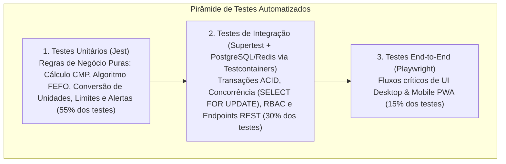

# 09. Estratégia de Testes, Segurança, Implantação (Docker/CI-CD) e Manutenção

**Projeto:** Japa em Casa — Sistema Profissional de Gestão de Estoque para Restaurantes  
**Módulo:** Engenharia de Qualidade (QA), DevSecOps e Operações de Produção

---

## 1. Estratégia de Testes Automatizados (Pirâmide de Testes)

Para garantir confiabilidade financeira e operacional (zero divergência de saldo ou erro de cálculo de CMP), adotamos uma pirâmide de testes rigorosa com meta de cobertura **>= 85% na camada de Domínio e Aplicação**:



### 1.1. Testes Unitários (`Jest` — Rápidos e Isolados)
Focados nas entidades e serviços de domínio (`src/modules/**/domain/`):
- **Cálculo de Custo Médio Ponderado (CMP):**
  - Entrada com estoque anterior zerado ($Q_0 = 0$);
  - Entrada com estoque anterior positivo e preços diferentes;
  - Precisão de 4 casas decimais (`Decimal.js`) sem erros de arredondamento;
  - Garantia de que saídas e transferências mantêm o CMP inalterado.
- **Algoritmo de Alocação FEFO:**
  - Seleção prioritária do lote com menor `expirationDate`;
  - Desempate por `receivedAt` (FIFO) quando dois lotes vencem no mesmo dia;
  - Alocação fracionada consumindo múltiplos lotes em sequência;
  - Ignorar automaticamente lotes com `expirationDate < Hoje` ou status `EXPIRED`/`QUARANTINED`;
  - Lançamento de `InsufficientStockException` quando a soma dos lotes válidos for menor que a quantidade solicitada.
- **Conversão de Unidades e Disparadores de Alerta:**
  - Conversão de `Caixa (10 KG)` -> `10,0000 KG` e diluição proporcional do custo unitário;
  - Verificação exata dos gatilhos `OUT_OF_STOCK`, `BELOW_SAFETY_STOCK`, `BELOW_MIN_STOCK`, `REORDER_POINT_REACHED` e `ABOVE_MAX_STOCK`.

### 1.2. Testes de Integração (`Supertest` + Banco de Testes Real)
Executados contra uma instância real do PostgreSQL e Redis em container descartável:
- **Teste de Concorrência (Race Condition / Pessimistic Locking):** Disparo simultâneo (`Promise.all`) de 5 requisições de saída de `3 KG` cada contra um produto que possui apenas `10 KG` em estoque. **Critério de aprovação:** Exatamente 3 requisições retornam `201 Created`, 2 requisições retornam `422 Unprocessable Entity (Saldo Insuficiente)` e o saldo final no banco é exatamente `1,0000 KG` (nunca negativo).
- **Teste de Recebimento Parcial de Compra:** Pedido de `50 KG` -> Recebimento de `30 KG` -> Verificação de que o estoque subiu apenas `+30 KG`, o status do pedido mudou para `PARCIALMENTE_RECEBIDO` e o saldo pendente é `20 KG`.
- **Teste de Imutabilidade e Estorno:** Tentativa de alterar/deletar movimentação (bloqueada) -> Execução de `/movements/:id/reverse` -> Verificação de restauração do saldo no lote e criação de registro em `audit_logs`.
- **Teste de Matriz RBAC:** Validar que o token de um `STOCK_CLERK` recebe `403 Forbidden` ao tentar aprovar um pedido de compra (`/purchases/:id/approve`) ou aprovar um inventário (`/inventory-counts/:id/approve`).

### 1.3. Testes End-to-End de Interface (`Playwright` — Desktop & Mobile Viewport)
Simulação de navegador real nos viewports Desktop (`1440x900`) e Mobile (`iPhone 14 / Pixel 7 - 390x844`):
- Fluxo completo: Login -> Cadastro de Produto -> Criação e Aprovação de Pedido de Compra -> Recebimento na Doca com criação de Lote -> Baixa para Produção validando FEFO -> Registro de Perda -> Visualização do impacto no Dashboard -> Exportação de Relatório em PDF e Excel.

---

## 2. Arquitetura de Segurança e Conformidade (LGPD)

| Camada de Segurança | Implementação Técnica Concreta |
| :--- | :--- |
| **Hash de Senhas** | **Argon2id** (`argon2` package) com configuração recomendada pela OWASP (memória: 64 MB, iterações: 3, paralelismo: 4). |
| **Gestão de Sessões e JWT** | *Access Token* JWT assinado com chave assimétrica/forte (expiração curta: `15m`) + *Refresh Token* opaco com rotação automática a cada uso, persistido com hash SHA-256 na tabela `refresh_tokens` e entregue via cookie `HttpOnly; Secure; SameSite=Strict`. |
| **Detecção de Roubo de Sessão** | Caso um `Refresh Token` já revogado seja reutilizado (*Token Replay*), o sistema invalida imediatamente todas as sessões ativas daquele usuário e registra um alerta de segurança. |
| **Proteção contra SQL Injection** | 100% das consultas utilizam **Prisma ORM** com *Prepared Statements* parametrizados. |
| **Validação de Entrada e XSS** | `ValidationPipe` global no NestJS com `whitelist: true` e `forbidNonWhitelisted: true` (rejeita qualquer propriedade não declarada no DTO), combinado com sanitização de HTML e Content Security Policy (CSP) via `Helmet`. |
| **Rate Limiting (Anti-Brute Force / DDoS)** | `@nestjs/throttler` apoiado no Redis: limite global de `100 req/min` por IP e limite estrito de `5 tentativas/min` no endpoint `/auth/login`. |
| **Conformidade LGPD** | Mínimo privilégio na coleta de dados; logs estruturados com redaction automático (`pino` redact) para nunca gravar `password`, `token` ou cabeçalhos `Authorization` em texto plano. |

---

## 3. Plano de Implantação (Docker, CI/CD, Backup e Monitoramento)

### 3.1. Containerização com Docker e Docker Compose
Toda a solução é empacotada em containers multi-stage enxutos (`node:20-alpine` com usuário não-root `node`):

```yaml
# Estrutura de referência do docker-compose.yml de Produção/Homologação
version: '3.9'
services:
  postgres:
    image: postgres:16-alpine
    restart: always
    environment:
      POSTGRES_USER: ${DB_USER}
      POSTGRES_PASSWORD: ${DB_PASSWORD}
      POSTGRES_DB: japa_estoque_db
    volumes:
      - pgdata:/var/lib/postgresql/data
    healthcheck:
      test: ["CMD-SHELL", "pg_isready -U ${DB_USER} -d japa_estoque_db"]
      interval: 10s
      timeout: 5s
      retries: 5

  redis:
    image: redis:7-alpine
    restart: always
    command: redis-server --appendonly yes --requirepass ${REDIS_PASSWORD}
    volumes:
      - redisdata:/data
    healthcheck:
      test: ["CMD", "redis-cli", "-a", "${REDIS_PASSWORD}", "ping"]
      interval: 10s
      timeout: 5s
      retries: 5

  backend:
    build:
      context: ./backend
      dockerfile: Dockerfile
    restart: always
    depends_on:
      postgres:
        condition: service_healthy
      redis:
        condition: service_healthy
    env_file: .env.production
    ports:
      - "3001:3001"

  frontend:
    build:
      context: ./frontend
      dockerfile: Dockerfile
    restart: always
    depends_on:
      - backend
    env_file: .env.production
    ports:
      - "3000:3000"

volumes:
  pgdata:
  redisdata:
```

### 3.2. Pipeline de CI/CD (GitHub Actions)
A cada *Pull Request* ou *Push* na branch `main`, o workflow `.github/workflows/ci-cd.yml` executa:
1. **Stage 1 — Qualidade e Tipagem:** `ESLint`, `Prettier Check` e `tsc --noEmit` no Frontend e Backend + `prisma validate`.
2. **Stage 2 — Testes Unitários e Integração:** Sobe serviços `postgres:16` e `redis:7` no runner do GitHub Actions, roda `prisma migrate deploy`, executa `jest --coverage` e valida o threshold mínimo de cobertura.
3. **Stage 3 — Testes E2E (Playwright):** Compila o projeto e executa a suíte de fluxos críticos de ponta a ponta.
4. **Stage 4 — Build & Deploy:** Constrói as imagens Docker otimizadas, publica no Container Registry (GHCR) e realiza o deploy sem downtime (*Zero-Downtime Rolling Update*) após executar as migrations versionadas do Prisma.

### 3.3. Política de Backup Automatizado e Recuperação de Desastres (DRP)
1. **Backup Diário e HorárioAutomatizado:** Container sidecar ou cronjob executando `pg_dump -Fc` (formato comprimido customizado do PostgreSQL) a cada 6 horas, criptografado com AES-256 e enviado para armazenamento externo em nuvem (AWS S3 / Cloudflare R2 / Backblaze B2).
2. **Retenção (Política GFS — Grandfather-Father-Son):**
   - Backups horários mantidos por 48 horas;
   - Backups diários mantidos por 30 dias;
   - Backups mensais mantidos por 12 meses.
3. **Teste de Restauração:** Procedimento documentado para restaurar qualquer snapshot em um banco limpo em menos de 15 minutos (`pg_restore --clean --if-exists -d japa_estoque_db backup.dump`).

### 3.4. Monitoramento e Observabilidade
- **Health Checks (`/api/v1/health`):** Implementado com `@nestjs/terminus`, verificando conectividade ativa com PostgreSQL, Redis e uso de disco/memória RAM.
- **Monitoramento de Erros (Sentry):** SDK integrado tanto no Next.js quanto no NestJS para captura automática de stack traces, breadcrumbs de ações do usuário e alertas de regressão de performance.
- **Logs Estruturados (Pino):** Saída padronizada em JSON contendo `timestamp`, `level`, `requestId`, `userId`, `method`, `path`, `statusCode` e `durationMs`.
